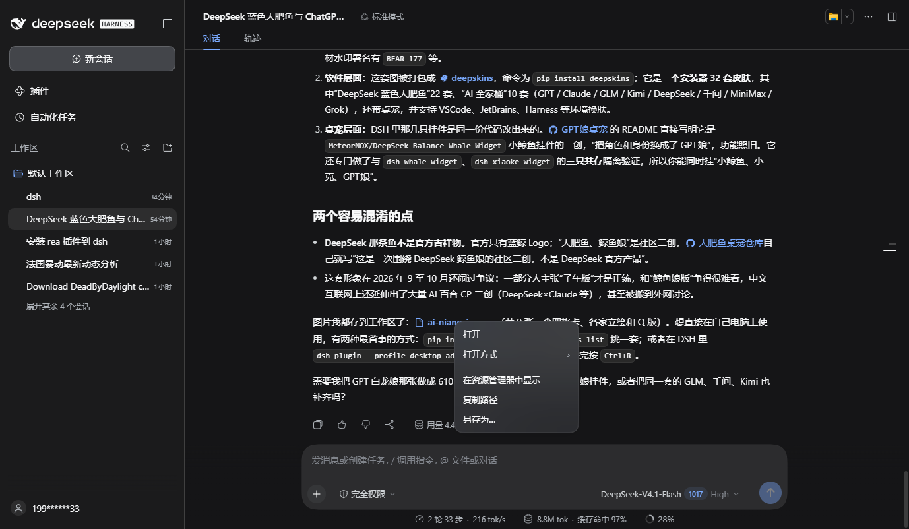

# dsh-link-actions

[](https://www.npmjs.com/package/dsh-link-actions)
[](LICENSE)

给 DSH 聊天里的链接加右键菜单：文件/目录可以「打开、在资源管理器中显示、复制路径、另存为」，HTTP(S) 链接可以「在默认浏览器中打开、复制链接」。

> Right-click menus for links in DeepSeek Harness chat: file and folder links can open, reveal, copy their path, or be saved; HTTP(S) links can open in the browser or copy the URL.
> Tested against the shipped `0.2.1-rc.2` runtime. Requires a DSH client build that serves client plugins (the desktop app and `dsh web` both do).



DSH 官方仓库目前**不接受外部 PR**（[CONTRIBUTING.zh.md](https://github.com/deepseek-ai/deepseek-harness/blob/master/CONTRIBUTING.zh.md) 第 9 行），所以这个能力以插件形式提供 —— 这也是官方推荐的扩展路径。DSH 客户端没有「单个链接」级别的 slot，插件在 document 的捕获阶段监听 `contextmenu`，识别 Markdown 渲染出的两种链接，自己绘制菜单。

## 安装

从 npm 安装：

```powershell
dsh plugin --profile desktop add dsh-link-actions
```

也可以直接从本仓库装（`lib/` 已随仓库提交，同样不需要构建）：

```powershell
dsh plugin --profile desktop add github:InnovationLou/dsh-link-actions
```

本地目录安装（改代码时用）：

```powershell
dsh plugin --profile desktop add link:E:\MyProject\dsh-link-actions
```

装完在 `~\.dsh\profiles\desktop\cordis.patch.yml` 末尾追加：

```yaml
- insert:
    - id: link-actions
      name: dsh-link-actions
```

**重启客户端**（不是按 `Ctrl+R`：插件条目在 Host 启动时装配）即可生效。

想换到别的 profile（比如 `dsh web` 用的那个），把上面两处 `desktop` 换成对应名字。

卸载：

```powershell
dsh plugin --profile desktop remove dsh-link-actions
```

再从 `cordis.patch.yml` 里删掉那三行。

## 菜单

文件、目录（聊天里的文件名按钮和 `fileMention`）：

| 菜单项 | 行为 |
| --- | --- |
| 打开 | 交给 Host 桌面用系统默认程序打开；目录则打开文件管理器 |
| 打开方式 › | 列出系统里已注册的关联应用，点其中一项打开 |
| 在资源管理器中显示 | 打开文件管理器并选中该文件 |
| 复制路径 | 复制解析后的绝对路径 |
| 另存为… | 读取文件字节后用「另存为」对话框写到你选的位置 |

HTTP(S) 链接（Markdown 里的 `<a>`）：

| 菜单项 | 行为 |
| --- | --- |
| 在默认浏览器中打开 | 新窗口打开 |
| 复制链接 | 复制 href |

## 实现要点

- **路径从哪来**：渲染器给文件链接的 `title` 是完整路径（`fileMention` 由 resolver 提供，`MarkdownFileLink` 是作者写下的目标），没有 `title` 时退回按钮文本。
- **相对路径**：用当前会话（`retainedBy.mainView` 命中的那个）的 `cwd` 拼成绝对路径，因为 Host 的 `openWorkspacePath` 会按 Host 进程的 cwd 解析相对路径。
- **动作复用既有 Remote**：`session.canOpenWorkspacePath`、`session.workspacePathApplications`、`session.openWorkspacePath`、`workspaceFiles.readBytes`，插件不带自己的传输层。
- **样式复用产品 token**：`--dsw-menu-surface-fill`、`--dsw-elevation-prominent`、`--dsw-alias-*` 等，跟随明暗主题。
- **零运行时依赖**：客户端半边是一段自包含 ES2022，构建只做 DSH 的 module-loader 握手（`window.__ModuleLoader__.load({ id, factory })`），没有打包器。

## 已知限制

- **只作用于会话正文**：`[data-chat-flow]` 之外（侧栏、文档预览）的链接保持原生行为。
- **目录没有「打开方式」**：系统没有目录级关联，悬停该项时会自行收起。
- **`[文字](相对路径)` 形式**：按钮里只有作者写的文字，拿不到真实路径时只提供「复制路径」。
- **另存为受 Host 读取上限约束**（`workspaceFiles` 的 `maxFileBytes`），超大文件会被拒绝；目录无法用这条路径保存。
- **应用图标可能不显示**：图标走 Host 的 `open-in-app/icon/<id>` 路由，取不到时该项会连同占位一起移除，标签仍然对齐。
- **依赖内部接口**：`dsh.client` 声明、Remote 名称、`data-chat-flow`、CSS Module 类名中的 `fileMention`/`fileLink` 属于产品内部实现，升级 DSH 后需回归一次。

## 已验证

在安装版的 `0.2.1-rc.2` 运行时（同一份 client bundle）上跑过：

| 场景 | 结果 |
| --- | --- |
| **从 npm 安装** | `dsh plugin add dsh-link-actions`（0.1.0，8 文件 / 71.5 kB）后在全新 profile 里启动客户端，右键菜单正常弹出 |
| **从 GitHub 安装** | `dsh plugin add github:InnovationLou/dsh-link-actions` 后在全新 profile 里启动客户端，右键菜单正常弹出 |
| 目录链接右键 | 菜单 5 项：打开 / 打开方式 / 在资源管理器中显示 / 复制路径 / 另存为 |
| 图片文件「打开方式」 | 列出系统关联：画图、照片、VS Code、Typora、Notepad++ … |
| 「另存为」一个 png | 提示「已保存」，文件落到下载目录，文件名保持不变 |
| HTTP(S) 链接右键 | 菜单 2 项：在默认浏览器中打开 / 复制链接 |
| 相对路径 | `ai-niang-images\fish-01-classic.png` 按会话 cwd 解析成功 |

`打开` / `在资源管理器中显示` 走的是同一个 `session.openWorkspacePath` 调用（`reveal` 分支已在代码层核对），未在自动化里真的弹出窗口。

## 开发

```powershell
node scripts/build.mjs          # src/ -> lib/（client.js 做 loader 握手）
node --check lib/client.js      # 语法自检
```

`tools/` 下是本机验证用的小工具（Node 24 自带 `WebSocket`，直接连 CDP）：`cdp-contextmenu.mjs` 验证链接菜单，`cdp-file-menu.mjs` 验证文件菜单，`cdp-open-with.mjs` 看「打开方式」子菜单，`cdp-save-as.mjs` 端到端跑「另存为」，`cdp-screenshot.mjs` 截图，`asar-head.mjs` 读安装包内的 `app.asar`。

`test/overlay.yml` 是把插件临时挂进某个 CLI profile 的 patch 覆盖层，配合 `dsh --profile <name> --patch test/overlay.yml --no-open --port 7401` 做隔离验证，不碰日常使用的 profile。

## License

MIT
